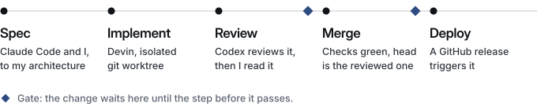

# I build AI products end to end. Coding agents write the code.

I design the architecture and direct AI coding agents, and I review every change before it ships. [OxFoundry](https://oxfound.com) is where I build and run the Ox family of tools.

**Open to AI product engineering roles and contract work.** San Francisco · [anatoly@koptev.me](mailto:anatoly@koptev.me) · [LinkedIn](https://www.linkedin.com/in/koptev) · [oxfound.com](https://oxfound.com) · [koptev.me](https://koptev.me)

## Three products

<a href="https://github.com/anatolykoptev/ox-say"><picture><source media="(prefers-color-scheme: dark) and (max-width: 1023px)" srcset="assets/product-oxsay-narrow-dark.svg"><source media="(max-width: 1023px)" srcset="assets/product-oxsay-narrow-light.svg"><source media="(prefers-color-scheme: dark)" srcset="assets/product-oxsay-wide-dark.svg"></picture></a>
<a href="https://github.com/anatolykoptev/vaelor"><picture><source media="(prefers-color-scheme: dark) and (max-width: 1023px)" srcset="assets/product-vaelor-narrow-dark.svg"><source media="(max-width: 1023px)" srcset="assets/product-vaelor-narrow-light.svg"><source media="(prefers-color-scheme: dark)" srcset="assets/product-vaelor-wide-dark.svg"></picture></a>
<a href="https://oxpulse.chat"><picture><source media="(prefers-color-scheme: dark) and (max-width: 1023px)" srcset="assets/product-oxpulse-narrow-dark.svg"><source media="(max-width: 1023px)" srcset="assets/product-oxpulse-narrow-light.svg"><source media="(prefers-color-scheme: dark)" srcset="assets/product-oxpulse-wide-dark.svg"></picture></a>

OxPulse's application source is private. Three parts are public: the [edge-node bundle](https://github.com/anatolykoptev/oxpulse-partner-edge), a [Rust SFU crate](https://crates.io/crates/oxpulse-sfu-kit) and the [chat SDK](https://www.npmjs.com/package/@oxpulse/chat-sdk) on npm.

## How the code gets written

I don't type this code. I decide what gets built and how it fits together, then direct coding agents: Claude Code plans and orchestrates, Devin implements, Codex reviews every pull request. Nothing ships until I've read the change.

<a href="https://oxfound.com/#method"><picture><source media="(prefers-color-scheme: dark) and (max-width: 1023px)" srcset="assets/method-narrow-dark.svg"><source media="(max-width: 1023px)" srcset="assets/method-narrow-light.svg"><source media="(prefers-color-scheme: dark)" srcset="assets/method-wide-dark.svg"></picture></a>

## Tools I build for the agents

Agents are only as good as what they can call. Most of what I build has an MCP server on it, and my own agents get a command-line tool and a skill before they get another server. I measured what that saved against my own transcripts: [MCP vs CLI for AI agents: what my token data showed](https://koptev.me/writing/mcp-vs-cli-ai-agents).

- [mcp-http-call](https://github.com/anatolykoptev/mcp-http-call) lists, describes and calls any tool on an HTTP MCP server from the shell. One Python file, standard library only.
- [agent-kb](https://github.com/anatolykoptev/agent-kb) searches agent memory and my wikis by meaning, in Russian and English, with embeddings computed on the Mac.
- [ats-check](https://github.com/anatolykoptev/ats-check) parses a resume PDF with five extractor families and matches it to a job description. A truth column separates fixes that are true from wording I can't claim.
- [go-job](https://github.com/anatolykoptev/go-job) is an MCP server for job, remote and freelance search, and [gtr-mcp](https://github.com/anatolykoptev/gtr-mcp) gives agents git worktrees with confirm-gated destructive calls.

## Fixes merged into other people's projects

10 pull requests merged in 7 repositories between 2026-02-03 and 2026-10-22. Star counts are the projects', read 2026-11-20. Four of them:

- remotion-dev/remotion (74K stars) [#10262](https://github.com/remotion-dev/remotion/pull/10262): don't kill Whisper when Metal falls back to CPU (2026-08-10)
- KnifeLemon/Filee (29K) [#378](https://github.com/KnifeLemon/Filee/pull/378): route Cyrillic, Greek and Latin Extended PDF text around a renderer that can't measure it (2026-10-22)
- MemTensor/MemOS (12K) [#966](https://github.com/MemTensor/MemOS/pull/966): PostgreSQL + pgvector graph database backend (2026-02-03)
- paradedb/paradedb (9.5K) [#5432](https://github.com/paradedb/paradedb/pull/5432): Japanese tokenizer options, Lindera NFKC normalization and reading form (2026-06-28)

The other six are [listed on oxfound.com](https://oxfound.com/#upstream).

## Libraries I pulled out of the products

12 npm packages and 8 Rust crates as of 2026-11-20, plus Go modules published by tag. Start with [ox-whisper](https://github.com/anatolykoptev/ox-whisper) (speech-to-text server in Rust, 25 European languages on one ARM CPU), [go-workflow](https://github.com/anatolykoptev/go-workflow) (a DAG workflow engine for Go with durable Postgres execution and approval flows) and [go-kit](https://github.com/anatolykoptev/go-kit) (the shared Go module under my services).

## Write to me

[anatoly@koptev.me](mailto:anatoly@koptev.me). I'm in San Francisco. The fastest way to judge the work is to read it: the repositories are below.
